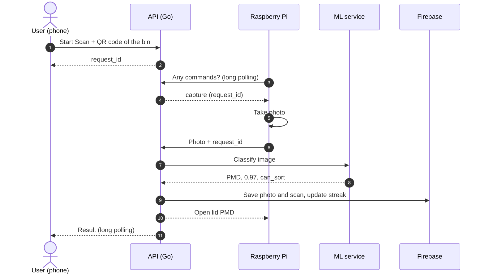
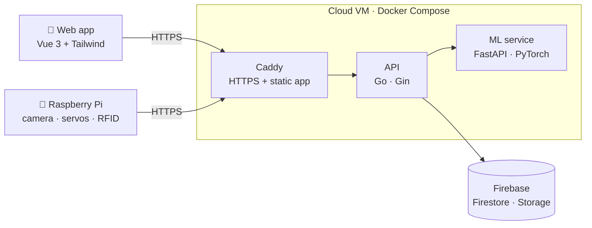

<div align="center">

# 🗑️ Raspberry Bin

**A smart waste bin that recognises an item with a camera and opens the right compartment.**


University of Twente · Module 5 Computer Systems · Team 27 · 2026

</div>

---

## About

People often throw waste into the wrong bin because they are not sure where it
belongs, and wrongly sorted waste contaminates recycling. Raspberry Bin takes
that decision away: you scan the QR code on the bin with your phone, the bin
takes a photo of your item, a neural network classifies it, and only the lid of
the correct compartment opens.

It sorts into the four Dutch household streams: **PMD** (plastic, metal, drink
cartons), **paper**, **organic** and **general waste**. Items it does not
recognise, or is not sure about, are rejected and all lids stay closed.

## Features

- 📷 **Camera classification** – ConvNeXt-Small model, 97 % accuracy on the test set
- 🚫 **Safe rejection** – unknown items and low-confidence results never open a lid
- 📱 **Web app** – log in, scan the bin's QR code and see the result on your phone
- 🔥 **Streaks and statistics** – personal history, daily streak, sorting stats per category
- 🛠️ **Admin dashboard** – users, activity log, bin statistics, manual lid control
- 🏷️ **RFID container check** – each compartment knows whether its container is in place
- 🔒 **Security by design** – see [Security](#security)

## How a scan works



The Pi only makes outgoing HTTPS requests, so it works behind any network
without open ports. Both the Pi and the app use long polling: the server holds
the request open and answers the moment something happens.

## Architecture



| Component | Tech | Folder |
|---|---|---|
| API | Go, Gin, Firestore, Cloud Storage | [`backend/`](backend) |
| ML service | Python, FastAPI, PyTorch, timm | [`ml/`](ml) |
| Web app | Vue 3, Vite, Tailwind CSS, qr-scanner | [`frontend/`](frontend) |
| Bin client | Python, picamera, gpiozero | `pi/` (on the `release` branch) |
| Reverse proxy | Caddy with automatic HTTPS | [`backend/Caddyfile`](backend/Caddyfile) |

## Classification model

Trained on 17,125 cleaned images in five classes (the four streams plus
`UNSUPPORTED`), split 80/10/10.

| Model | Size | Test accuracy | Macro F1 |
|---|---|---|---|
| **ConvNeXt-Small** (deployed) | 198 MB | **0.972** | **0.970** |
| MobileNetV3-Large | 17 MB | 0.962 | 0.962 |

Each model stores its own confidence threshold; below it the item is rejected
instead of guessed. Details in [`ml/README.md`](ml/README.md).

## Security

The project follows a security-by-design approach:

- **HTTPS everywhere**, strict Content-Security-Policy, HSTS
- **Passwords** hashed with bcrypt; accounts lock for 5 minutes after 5 wrong passwords (counted in a database transaction)
- **Sessions** are random tokens stored only as SHA-256 hashes, expire after 8 hours
- **Roles** checked on every request; a user token never opens admin routes
- **QR codes** carry a secret per bin (stored hashed), so scans can only be started at the bin
- **Device key** for the Pi, compared in constant time; scans need a one-time request ID
- **Input validation**: image type detected from content, size limits, strict IDs, random storage names
- **Rate limits** per IP and per user, limits on open long-polling requests
- **Isolated ML service** on an internal Docker network without internet access, running as non-root
- **Fail closed**: if the classifier is down, no lid opens

## Getting started

### Backend, ML and web app

```bash
# 1. Build the web app
cd frontend && npm ci && npm run build && cd ..

# 2. Configure the server and add the Firebase key (never commit either)
printf 'DOMAIN=your.domain\nDEVICE_API_KEY=%s\n' "$(openssl rand -hex 32)" > backend/.env
cp /path/to/firebase-key.json backend/serviceAccountKey.json

# 3. Start API, ML service and Caddy
cd backend && docker compose up -d --build

# 4. Create an admin and register a bin (prints the QR code to print)
docker compose run --rm api ./create-admin -username admin
docker compose run --rm api ./create-bin -bin bin-1
```

The full API is described in [`backend/API.md`](backend/API.md).

### Web app development

```bash
cd frontend && npm install && npm run dev   # proxies /api to localhost:8080
```

### Tests

```bash
cd backend && go test ./...
docker run --rm raspberry-bin-ml python -m pytest ml/tests
```

## Repository structure

```
backend/      Go API, Dockerfile, docker-compose, Caddyfile, API docs
frontend/     Vue 3 web app (users and admin dashboard)
ml/           Training script, inference service, models (Git LFS)
Assignments/  Course documents (requirements, design, testing)
```

## Team

| | Role |
|---|---|
| Sepehr Marjovi | Physical build and electronics |
| Mack Glass | Physical build and electronics |
| Omar Hassan | Physical build and electronics |
| Artem Novokhatnii | Dataset, classification model, admin dashboard |
| Ruslan Morozov | ML inference service, web app |
| Bohdan Sharloimov | Backend, infrastructure, Raspberry Pi integration |

<div align="center">
<sub>Made at the University of Twente, 2026</sub>
</div>
